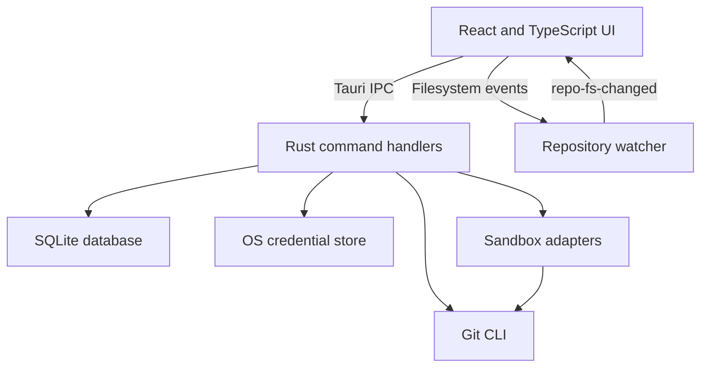

<div align="center">

  

  # Stage0

  [](./LICENSE)
  [](https://tauri.app/)
  [](https://react.dev/)
  [](https://www.rust-lang.org/)
  [](https://www.typescriptlang.org/)
  [](https://tailwindcss.com/)

</div>

Stage0 is a local-first desktop application for reviewing changes between Git branches. It provides three-dot diffs, merge-conflict previews, Git blame, and locally stored Virtual MR sessions without checking out a merge into the current working tree.

Stage0 is built with Tauri 2, Rust, React, and TypeScript. It uses the Git executable installed on the user's machine.

## Features

- Compare two refs using Git's three-dot diff semantics and browse changed files with addition and deletion counts.
- Inspect predicted merge conflicts and preview conflicted files.
- View file-level and inline Git blame.
- Keep local Virtual MR sessions, labels, discussions, and comments in an embedded SQLite database encrypted with SQLCipher and a unique installation key held by the OS credential store. See [database encryption and recovery](docs/architecture/database_encryption.md).
- Monitor the active repository for filesystem changes and refresh the review view.
- Fetch, pull, and rebase branches; manage local branches, tags, and remotes.
- Open repositories and files in the system file manager, terminal, or Visual Studio Code.
- Store Git credential metadata locally and secrets in the operating system credential store.
- Run bounded, read-only AI code reviews on committed snapshots, inspect evidence-backed findings, and explicitly publish them as unresolved discussions.

## Important behavior and limitations

Stage0's diff and conflict checks do not check out or merge branches into the working tree or Git index. Conflict detection uses `git merge-tree --write-tree`; Git may write tree or blob objects to the repository's object database while calculating the result. The guarantee is about leaving the working tree and index untouched, not about making no disk writes at all.

Virtual MR sessions are local application records. Stage0 does not currently create or update pull requests on GitHub, GitLab, or other hosting services. Fetch and pull contact Git remotes, and pull or rebase can change local repository state. Stage0 does not provide a push operation.

Sandbox adapters have different scopes:

| Adapter | Behavior | Limitations |
| --- | --- | --- |
| In-memory | Supports diff and conflict inspection without checking out a branch or changing the working tree or index. | Git may write result tree/blob objects to the repository object database. Does not run commands. |
| Local worktree | Creates a detached worktree at the compare ref and runs commands in it. | It does not create the predicted merge result. Commands run on the host with the current user's permissions and can access files outside the worktree; a worktree is not operating-system isolation. |
| Docker | Copies the selected source tree into a writable container and runs commands there. No host directory is mounted by Stage0. | It does not create the predicted merge result. Network access is enabled; Stage0 does not set CPU, memory, or process limits. Container isolation also depends on the installed Docker runtime and host configuration. |

The native **AI code review** panel supports OpenAI Responses, Anthropic Messages, Gemini generateContent, local Ollama, and compatible Custom/xAI Chat Completions endpoints. It reads fixed Git object IDs, not the current checkout or uncommitted edits. Remote review requires explicit source-sharing consent. API keys stay in the OS credential store; mandatory sensitive-path filtering, best-effort secret redaction, strict tool validation and bounded execution apply to every native run. These protections cannot detect every secret or prove a model finding is correct. Model/tool compatibility still depends on the selected provider and model. Cloud API-key connectivity checks make a small, source-free function-calling request and can incur provider charges. The Ollama daemon check only lists models; a successful daemon check does not establish function-calling support.

Runs continue when the panel is closed, are reachable from the status bar, and store local history and metadata-only traces. Publishing is an explicit user action and creates unresolved discussions; it never approves the MR, resolves an existing discussion, or claims tests were run. Budget exhaustion, refusals and interrupted responses do not become successful reviews. See [AI review harness](docs/architecture/ai_review_harness.md) for tools, budgets, limitations and tests.

CLI/subscription connectivity paths remain separate from this native review runtime. The **External MCP / CLI connectors** panel prepares integration with explicit, source-free MCP Streamable HTTP discovery (pinned revision `2025-11-25`) and a non-executing CLI PATH preflight. Discovery supports JSON/SSE responses, paginated tool catalogs and temporary-session cleanup, but does not attach or call external tools. Stdio launch, legacy HTTP+SSE, newer MCP revisions, OAuth/authenticated MCP and actual CLI review execution are not enabled. Local configuration validation still performs no network/process operation, and imported/restored verification claims are cleared. See [external connector preparation](docs/architecture/external_harness_connectors.md) for the model-adapter boundary, structured CLI contract and remaining attachment gates.

AI settings in Preferences share the dialog's Apply/OK/Cancel draft transaction,
including provider configuration, pending API-key replacements, MCP definitions,
external agents and guardrail policy. Authentication and execution/check actions
remain separate immediate operations. See [AI Preferences transaction](docs/architecture/ai_preferences_transaction.md).

Description drafts are generated locally from commit metadata, not by an LLM. Saved HTTPS Git credentials can be used for remote ref discovery and cloning with an origin-scoped helper; Git may also use helpers configured by the user or operating system. New remote URLs must use HTTP(S) or SSH and may not embed credentials or query-string secrets. Git subprocesses block external helper protocols such as `ext::` and local `file://` remotes.

MCP environment values are saved in ordinary local preferences and included in configuration exports, so do not put secrets in those fields. The AI/MCP tool bridge exposes terminal execution only for Docker, never for the host-backed Local Worktree. Terminal commands that require confirmation are refused because Stage0 does not yet have an approval dialog; write confirmation is enabled by default, so terminal tools are unavailable until that policy is explicitly disabled. Markdown previews block remote images to avoid contacting third parties just by opening a review. Viewer-font choices may request stylesheets from Google Fonts (`fonts.googleapis.com`) and font files from `fonts.gstatic.com`; local/system fallbacks are used if these requests fail. AI re-verification is disabled and its legacy command refuses verification writes; resolving discussions manually never automatically approves a session. Historical approval/verification records are retained, but are not evidence-backed AI results. Assigned reviewers are not persisted across application restarts.

Stage0 has no built-in update checker, downloader or installer. Install newer
versions manually; version and build metadata remain available in About.

## Requirements

- Git 2.38 or later is recommended for `git merge-tree --write-tree`.
- Node.js >= 20 (Node 24 LTS recommended, configured via `.nvmrc` and `.node-version`).
- pnpm >= 9 (pnpm 11+ supported and pinned via `packageManager`). Note: `npm` and `yarn` are blocked by a preinstall check.
- Rust 1.89 or later (stable recommended).
- Perl 5 for compiling the bundled OpenSSL used by SQLCipher. On Windows, Strawberry Perl is suitable.
- Native build tools for your platform:
  - Windows: Microsoft C++ Build Tools and WebView2 Runtime.
  - macOS: Xcode Command Line Tools.
  - Linux: WebKit2GTK 4.1 development packages, OpenSSL development packages, `pkg-config`, and a C/C++ toolchain. Ubuntu/Debian users can install the common requirements with:

    ```bash
    sudo apt update
    sudo apt install build-essential perl pkg-config libwebkit2gtk-4.1-dev libssl-dev libsecret-1-dev libayatana-appindicator3-dev librsvg2-dev libfontconfig1-dev libfreetype6-dev patchelf
    ```

## Development

Clone the repository and install frontend dependencies using **pnpm**:

```bash
git clone https://github.com/anhquoctran/stage0.git
cd stage0

# Switch to matching Node.js version using nvm (macOS/Linux) or nvm-windows
nvm use # or on Windows: nvm use 24.18.0

# Install dependencies manually if needed (only pnpm is allowed). Development launchers run this automatically on every start.
pnpm install
```

Run the native desktop application with frontend and Rust hot reload:

```bash
pnpm run dev:app
```

The web development server can be started with `pnpm run dev:web`, but most repository features require the Tauri backend and are not available in a regular browser.

Run the available static checks:

```bash
pnpm run typecheck
cd backend && cargo check
```

To reset the desktop app to first-launch local state, quit Stage0 and run
`pnpm reset:app-state` to preview, then `pnpm reset:app-state -- --yes` to apply.
The script archives application data and WebView state in a dated backup. It
keeps OS-vault keys so encrypted backups remain recoverable; see
[database encryption and recovery](docs/architecture/database_encryption.md).

## Build

Build the frontend assets only:

```bash
pnpm run build:web
```

Build and package the native desktop application for the current platform:

```bash
pnpm run build:app
```

The desktop build runs the TypeScript check and writes Tauri bundle artifacts under `backend/target/release/bundle/`.

Every project build command increments the SemVer PATCH version once before building and synchronizes the package, Cargo, Tauri, and About metadata. This also applies to web-only builds; if a build fails, its version increment is retained.

## Software updates and releases

Installed Stage0 builds check GitHub Releases daily, with an option to disable
automatic checking in **About Stage0**. Downloads and installation require user
actions. Packages and their signed versions are verified before installation;
active reviews, Git operations and external agent work block installation.

In-app updates support Linux x86_64 AppImage, Windows x86_64 NSIS, and macOS
Apple Silicon/Intel applications. Debian/RPM installations use manual or package
manager upgrades. Older Stage0 builds need one manual installation of the first
updater-enabled release.

The release workflow builds a fixed `vMAJOR.MINOR.PATCH` tag on all four targets
and publishes only after every updater package passes signature verification.
It calls Tauri directly, without the local build script's version bump. See the
[release and signing procedure](docs/architecture/software_updater.md).

## Architecture



Both sources use a feature-based layout. Entry points remain at `frontend/main.tsx`
and `backend/src/lib.rs`; see [Feature layout](docs/architecture/feature_layout.md)
for ownership and import conventions.

| Path | Contents |
| --- | --- |
| `frontend/common/`, `backend/src/common/` | Shared UI/utilities and process support. |
| `frontend/core/`, `backend/src/core/` | App shell, lifecycle, IPC registration, window/menu management, SQLite connection and migrations. |
| `frontend/features/` | Each feature's components, stores, services, types and constants. |
| `backend/src/features/` | Each feature's command handlers, domain logic and persistence methods. |
| `scripts/` | Cross-platform development and build scripts. |

## Contributing

Contributions are welcome. See [CONTRIBUTING.md](./CONTRIBUTING.md) for the development workflow and pull request guidelines. By participating, you agree to follow the [Code of Conduct](./CODE_OF_CONDUCT.md).

## Security

Please do not report security vulnerabilities in public issues. Follow the private reporting instructions in [SECURITY.md](./SECURITY.md).

## Third-party attributions

Stage0 uses icons from Font Awesome Free 7 by Fonticons, Inc. The icon artwork is licensed under [CC BY 4.0](https://creativecommons.org/licenses/by/4.0/); the Font Awesome code packages are MIT licensed. See the [Font Awesome Free license](https://fontawesome.com/license/free).

## License

Stage0 is distributed under the [MIT License](./LICENSE).
Bundled SQLCipher and OpenSSL notices are included in
[third-party notices](THIRD_PARTY_NOTICES.txt) and packaged with the desktop app.
