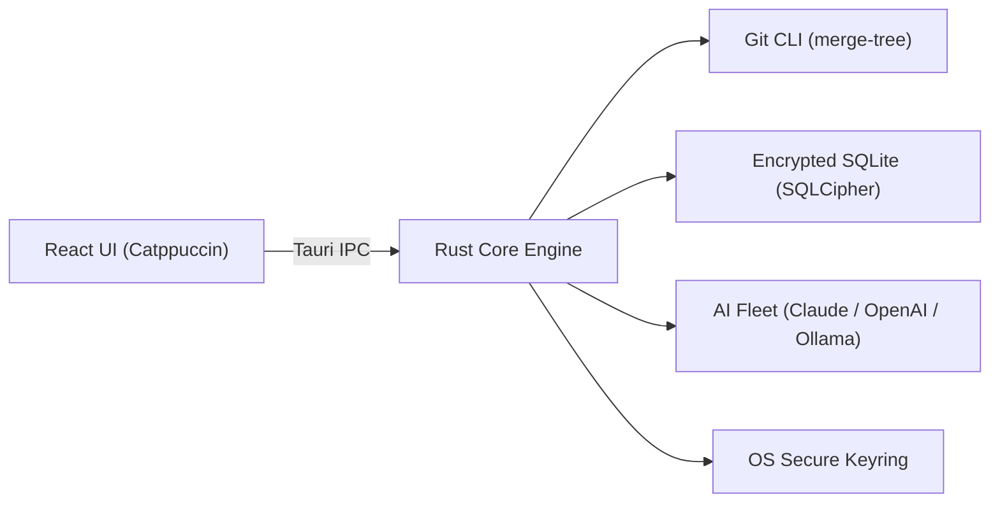

<div align="center">

  

  # Stage0

  ### Autonomous AI Code Review. Before You Push.

  [](https://anhquoctran.github.io/stage0/)
  [](https://github.com/anhquoctran/stage0/releases/latest)
  [](./LICENSE)
  [](https://anhquoctran.github.io/stage0/#download)

  <p align="center">
    <a href="https://anhquoctran.github.io/stage0/"><strong>Website &amp; Demo</strong></a> &nbsp;•&nbsp;
    <a href="https://anhquoctran.github.io/stage0/#download"><strong>Download App</strong></a> &nbsp;•&nbsp;
    <a href="https://anhquoctran.github.io/stage0/#quickstart"><strong>Quick Start</strong></a> &nbsp;•&nbsp;
    <a href="./docs/"><strong>Documentation</strong></a>
  </p>

</div>

---

**Stage0** is a local-first, privacy-focused desktop application that acts as an autonomous AI code reviewer for your Git workflow. Inspect branch diffs, audit security flaws, enforce architectural boundaries, and predict merge conflicts in-memory — **all before pushing to remote.**

## Key Capabilities

- **100% Local & Private**: Your source code never leaves your computer without consent. Zero mandatory telemetry. Supports local offline models via **Ollama / LM Studio** as well as Claude 3.7, GPT-4o, and Gemini 2.0.
- **Specialized AI Review Fleet**: Deploy targeted reviewer personas (Security Sentinel, Architecture Guardian, Performance Auditor) rather than generic chat assistants.
- **In-Memory Virtual Sandbox**: Evaluates 3-way merge diffs and predicts conflicts in-memory via `git merge-tree`. Never touches or checks out your active working tree.
- **Interactive Diff & One-Click Patch**: Chat on diff lines, discuss review findings directly with AI agents, and apply suggested patches in one click.
- **Zero Plaintext Secrets**: API keys are vaulted in your operating system's native secure keyring (Windows Credential Manager, macOS Keychain, Linux Libsecret) and zeroized in memory immediately upon use.

---

## Downloads

Installers and packages for all major operating systems are available on our [Website](https://anhquoctran.github.io/stage0/#download) and [GitHub Releases](https://github.com/anhquoctran/stage0/releases/latest):

| Platform | Recommended Format | All Available Formats |
| :--- | :--- | :--- |
| **Windows** | `64-bit Installer (.exe)` | `.exe`, `.msi` |
| **macOS** | `Apple Silicon (.dmg)` | Apple Silicon (`arm64`), Intel (`x64`) |
| **Linux** | `Universal AppImage (.AppImage)` | `.AppImage`, `.deb` (Debian/Ubuntu), `.rpm` (Fedora/RHEL), `.tar.gz` |

---

## Quick Start

Stage0 is built with [Tauri v2](https://tauri.app/), [Rust](https://www.rust-lang.org/), [React 19](https://react.dev/), [TypeScript](https://www.typescriptlang.org/), and [Tailwind CSS 4](https://tailwindcss.com/).

### Prerequisites
- **Git** 2.38+ (recommended for `git merge-tree`)
- **Node.js** >= 20 (`node 24 LTS` recommended)
- **pnpm** >= 9 (`pnpm install`)
- **Rust** 1.89+ (edition 2021)

### Run Locally
```bash
# 1. Clone repository
git clone https://github.com/anhquoctran/stage0.git
cd stage0

# 2. Install dependencies (pnpm is enforced)
pnpm install

# 3. Start native desktop app with hot-reload
pnpm dev:app
```

### Static Checks & Build
```bash
# Run architecture & type checks
pnpm check:architecture
pnpm typecheck

# Build optimized desktop installer for current OS
pnpm build:app
```

---

## Architecture



For deep dives into internal subsystems and design contracts, explore the [`docs/`](./docs/) directory:
- [Feature Layout & Conventions](docs/architecture/feature_layout.md)
- [AI Review Harness & Budgets](docs/architecture/ai_review_harness.md)
- [Database Encryption & Recovery](docs/architecture/database_encryption.md)
- [Software Updater & Signing](docs/architecture/software_updater.md)

---

## Contributing

Contributions, issues, and feature requests are welcome! Feel free to check our [Contributing Guide](./CONTRIBUTING.md) and [Code of Conduct](./CODE_OF_CONDUCT.md).

For security reports, please refer to [SECURITY.md](./SECURITY.md).

---

## License

Stage0 is open source software distributed under the [MIT License](./LICENSE).  
Icons by [Font Awesome Free](https://fontawesome.com/license/free) (CC BY 4.0 & MIT).
