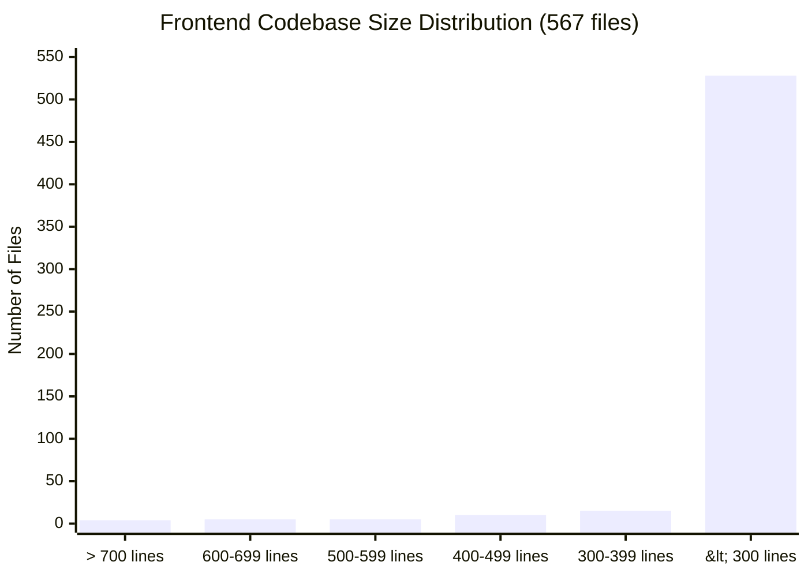
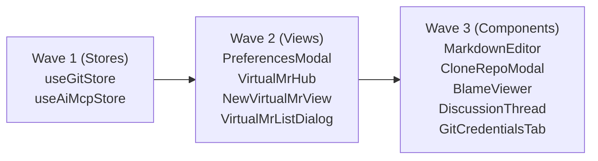

# Frontend Refactor Report & Agent Handoff Specification

> **Date**: 2026-10-22  
> **Target Scope**: Frontend codebase (`frontend/` directory, 567 TypeScript/TSX files)  
> **Status**: Ready for Agent Execution  
> **Companion Document**: [Feature Layout](feature_layout.md) · [Backend Refactor Report](backend_refactor_analysis.md) · [AGENTS.md](../../AGENTS.md)

---

## 1. Executive Summary & Size Distribution

A comprehensive audit of the Stage0 frontend codebase identified **24 files exceeding 400 lines**, with **14 files exceeding 500 lines** (the maximum threshold enforced for backend Rust files and recommended target for frontend maintainability).



- **Target budget**: Aim for ~300 lines per file; review boundaries at 400 lines; target max 500 lines per file.
- **Healthy majority**: **528 files (~93.1%)** are already concise (< 300 lines).
- **Core refactor targets**: The top 14 files (≥ 500 lines) represent the bulk of cognitive load and architectural coupling.

---

## 2. Inventory of Large Files (≥ 400 lines)

| # | File Path | Physical Lines | Module Type | Complexity | Recommended Action |
|---|---|:---:|---|:---:|---|
| 1 | [`frontend/features/git/store/useGitStore.ts`](../../frontend/features/git/store/useGitStore.ts) | **895** | Zustand Store | High | Decompose into 5 domain slices |
| 2 | [`frontend/features/ai/store/useAiMcpStore.ts`](../../frontend/features/ai/store/useAiMcpStore.ts) | **771** | Zustand Store | High | Decompose into 4 slices + persistence service |
| 3 | [`frontend/features/preferences/components/PreferencesModal.tsx`](../../frontend/features/preferences/components/PreferencesModal.tsx) | **716** | Modal View | High | Extract `usePreferencesDraft` hook + tab view |
| 4 | [`frontend/features/virtual-mr/components/VirtualMrHub.tsx`](../../frontend/features/virtual-mr/components/VirtualMrHub.tsx) | **704** | Feature Hub | High | Extract Header, MetadataBar, Overview & Commits tabs |
| 5 | [`frontend/features/virtual-mr/components/NewVirtualMrView.tsx`](../../frontend/features/virtual-mr/components/NewVirtualMrView.tsx) | **664** | Form View | High | Extract Header, FormSection, CommitsList |
| 6 | [`frontend/features/ai/components/AiMcpTab.tsx`](../../frontend/features/ai/components/AiMcpTab.tsx) | **661** | Feature Tab | Medium | Extract modal state hook + sub-views |
| 7 | [`frontend/features/virtual-mr/components/VirtualMrListDialog.tsx`](../../frontend/features/virtual-mr/components/VirtualMrListDialog.tsx) | **642** | Dialog View | Medium | Extract SearchBox, ListItem row, PaginationBar |
| 8 | [`frontend/features/git/components/CloneRepoModal.tsx`](../../frontend/features/git/components/CloneRepoModal.tsx) | **612** | Modal View | Medium | Extract UrlValidation, DestinationPicker, Credentials |
| 9 | [`frontend/features/git/components/repository-settings/RepositoryAgentsTab.tsx`](../../frontend/features/git/components/repository-settings/RepositoryAgentsTab.tsx) | **609** | Feature Tab | Medium | Extract CustomBotModal, CustomRulesSection |
| 10 | [`frontend/common/components/MarkdownEditor.tsx`](../../frontend/common/components/MarkdownEditor.tsx) | **601** | Common Component | High | Extract Toolbar, MentionPopup, ImageDrop hook |
| 11 | [`frontend/features/virtual-mr/components/DiscussionThread.tsx`](../../frontend/features/virtual-mr/components/DiscussionThread.tsx) | **596** | Component | Medium | Extract CommentItem, ReplyForm, author utils |
| 12 | [`frontend/features/git/components/BlameViewer.tsx`](../../frontend/features/git/components/BlameViewer.tsx) | **581** | Viewer Component | High | Extract Toolbar, CommitDetailModal, LinesTable |
| 13 | [`frontend/features/credentials/components/GitCredentialsTab.tsx`](../../frontend/features/credentials/components/GitCredentialsTab.tsx) | **570** | Feature Tab | Medium | Extract VaultBanner, CredentialItem, AddModal |
| 14 | [`frontend/core/components/layout/MainLayout.tsx`](../../frontend/core/components/layout/MainLayout.tsx) | **535** | App Layout | Medium | Extract ModalsContainer, SplitterCoordinator |
| 15 | [`frontend/features/git/components/GitGraphModal.tsx`](../../frontend/features/git/components/GitGraphModal.tsx) | **490** | Modal View | Medium | Extract GraphCanvas, GraphControls |
| 16 | [`frontend/features/ai/components/BotReviewerModal.tsx`](../../frontend/features/ai/components/BotReviewerModal.tsx) | **481** | Modal View | Medium | Extract PromptConfigForm, CategorySelector |
| 17 | [`frontend/features/git/components/GitBinaryTab.tsx`](../../frontend/features/git/components/GitBinaryTab.tsx) | **461** | Feature Tab | Medium | Extract BinaryDetectionCard, BinaryListTable |
| 18 | [`frontend/core/components/layout/menu-bar/MenuBarRepositoryMenu.tsx`](../../frontend/core/components/layout/menu-bar/MenuBarRepositoryMenu.tsx) | **457** | Menu Dropdown | Medium | Extract RecentReposSubmenu, GitActionsSubmenu |
| 19 | [`frontend/features/git/components/ConflictViewer.tsx`](../../frontend/features/git/components/ConflictViewer.tsx) | **448** | Viewer Component | High | Extract ConflictPane, ConflictResolutionBar |
| 20 | [`frontend/features/ai/components/AiMcpProviderDetailsModal.tsx`](../../frontend/features/ai/components/AiMcpProviderDetailsModal.tsx) | **437** | Modal View | Medium | Extract ProviderEndpointForm, ModelListTable |
| 21 | [`frontend/features/git/components/FileList.tsx`](../../frontend/features/git/components/FileList.tsx) | **425** | Sidebar View | Medium | Extract FileTreeItem, FileListFilterBar |
| 22 | [`frontend/features/ai/components/SandboxTab.tsx`](../../frontend/features/ai/components/SandboxTab.tsx) | **408** | Feature Tab | Medium | Extract SandboxInstanceCard, SandboxConfigForm |
| 23 | [`frontend/features/ai/components/ExternalAgentsTab.tsx`](../../frontend/features/ai/components/ExternalAgentsTab.tsx) | **402** | Feature Tab | Medium | Extract AcpAgentCard, AcpAgentModalForm |
| 24 | [`frontend/features/virtual-mr/store/useVirtualMrStore.ts`](../../frontend/features/virtual-mr/store/useVirtualMrStore.ts) | **401** | Zustand Store | Low | Already sliced; finish moving remaining root actions |

---

## 3. Detailed Architectural Blueprints for Priority Targets

### Tier 1: Giant Zustand Stores (Highest Priority)

#### 1. `frontend/features/git/store/useGitStore.ts` (895 lines → ~90 lines facade)
- **Current Problem**: Acts as the central "god-store" combining repository lifecycles, branch comparisons, diff payloads, merge/rebase conflict reports, blame data, sandbox execution, and UI dialog toggles.
- **Decomposition Structure**:
  - `frontend/features/git/store/slices/createGitRepoSlice.ts`: Repository open, recent repos, validate, clone, and native menu synchronization.
  - `frontend/features/git/store/slices/createGitDiffSlice.ts`: Base/compare branches, diff payload fetch, file selection, split/unified view mode.
  - `frontend/features/git/store/slices/createGitConflictBlameSlice.ts`: Conflict detection, in-memory merge reports, blame payload, line highlights.
  - `frontend/features/git/store/slices/createGitSandboxSlice.ts`: Sandbox types (in-memory, docker), adapter info, instances, execution status.
  - `frontend/features/git/store/slices/createGitUiModalsSlice.ts`: Booleans and toggles for `isPullFromOpen`, `isMergeFromOpen`, `isRebaseFromOpen`, `isGitGraphOpen`, `isCloneModalOpen`, `isRemoteUrlFromOpen`, toast notifications.
  - `frontend/features/git/store/useGitStore.ts`: Re-export facade combining all slices with `create<GitState>((...a) => ({ ...createGitRepoSlice(...a), ... }))`.
- **Contract Guarantee**: `useGitStore` type signature and all selectors remain 100% backward-compatible. No consumer components need import changes.

#### 2. `frontend/features/ai/store/useAiMcpStore.ts` (771 lines → ~90 lines facade)
- **Current Problem**: Mixes synchronous localStorage/preferences.json serialization, OS Keyring IPC (`store_ai_api_key`), MCP server runtime state, Guardrail audit logs, and ACP external agents.
- **Decomposition Structure**:
  - `frontend/features/ai/services/aiMcpPersistence.ts`: `loadPersistedState()` and `persistState()` with secret key zeroization/redaction and fallback handling.
  - `frontend/features/ai/store/slices/createAiConfigSlice.ts`: AI config (provider, model, baseUrl, reasoningEffort), API key keyring calls, dynamic model fetching.
  - `frontend/features/ai/store/slices/createMcpServersSlice.ts`: MCP server configs, verification status, enable/disable toggle, add/update/delete.
  - `frontend/features/ai/store/slices/createGuardrailsSlice.ts`: Guardrail policy, evaluation results, audit logs.
  - `frontend/features/ai/store/slices/createExternalAgentsSlice.ts`: ACP agent configs and lifecycle updates.
  - `frontend/features/ai/store/useAiMcpStore.ts`: Root facade combining slices.

---

### Tier 2: Large Views & Modals (600 – 720 lines)

#### 3. `frontend/features/preferences/components/PreferencesModal.tsx` (716 lines → ~150 lines)
- **Current Problem**: Holds 16+ separate `useState` hooks for font, theme, diff, blame, and sandbox draft values, along with 80+ lines of effect synchronization on modal open/close.
- **Decomposition Structure**:
  - `frontend/features/preferences/hooks/usePreferencesDraft.ts`: Encapsulates all draft state, baseline comparison, change counters, reset to default, and commit actions.
  - `frontend/features/preferences/components/PreferencesTabContainer.tsx`: Renders the active category tab (General, Theme, Font, Diff, AI Overview, Git Binary, Credentials, etc.).
  - `PreferencesModal.tsx`: Pure layout shell containing TopBar, NavTree, TabContainer, and Footer.

#### 4. `frontend/features/virtual-mr/components/VirtualMrHub.tsx` (704 lines → ~120 lines)
- **Current Problem**: Renders the complete MR detail view including the top action header, metadata pills/popovers, and embedded sub-tabs.
- **Decomposition Structure**:
  - `frontend/features/virtual-mr/components/hub/VirtualMrHeader.tsx`: Title inline editor, friendly MR ID badge (`!{n}`), status badge, TabBranchSelector source/target, and AI Review trigger button.
  - `frontend/features/virtual-mr/components/hub/VirtualMrMetadataBar.tsx`: Assignee badge, Reviewers bot popover list, Labels popover list, and sub-tab navigation buttons (`overview`, `commits`, `diff`).
  - `frontend/features/virtual-mr/components/hub/VirtualMrOverviewTab.tsx`: Description markdown preview/editor and discussion board.
  - `frontend/features/virtual-mr/components/hub/VirtualMrCommitsTab.tsx`: List of commits between source and target branches.
  - `VirtualMrHub.tsx`: Integrates the header, metadata bar, and tab panels.

#### 5. `frontend/features/virtual-mr/components/NewVirtualMrView.tsx` (664 lines → ~140 lines)
- **Current Problem**: Large creation form containing branch comparison, metadata inputs, and diff previews.
- **Decomposition Structure**:
  - `frontend/features/virtual-mr/components/new-mr/NewVirtualMrHeader.tsx`: Branch selectors, swap button, conflict warning badge.
  - `frontend/features/virtual-mr/components/new-mr/NewVirtualMrFormSection.tsx`: Title input, description markdown editor, AI generate draft button.
  - `frontend/features/virtual-mr/components/new-mr/NewVirtualMrCommitsList.tsx`: Commit comparison table.

#### 6. `frontend/features/virtual-mr/components/VirtualMrListDialog.tsx` (642 lines → ~150 lines)
- **Current Problem**: Contains complex search query tokenization, suggestion dropdown keyboard handlers, row items, and pagination controls.
- **Decomposition Structure**:
  - `frontend/features/virtual-mr/components/list/VirtualMrSearchBox.tsx`: Search input with token parsing and suggestion dropdown listbox.
  - `frontend/features/virtual-mr/components/list/VirtualMrListItem.tsx`: Single MR list item row (title, status badge, avatar, friendly ID, branch arrows).
  - `frontend/features/virtual-mr/components/list/VirtualMrPaginationToolbar.tsx`: Page size dropdown, previous/next buttons, and status indicator.

---

### Tier 3: Feature Components & Viewers (500 – 612 lines)

#### 7. `frontend/common/components/MarkdownEditor.tsx` (601 lines → ~160 lines)
- **Decomposition Structure**:
  - `frontend/common/components/markdown-editor/MarkdownToolbar.tsx`: Formatting actions (Bold, Italic, Heading, Code, Quote, List).
  - `frontend/common/components/markdown-editor/MarkdownMentionPopup.tsx`: Popover listbox for `@mention` completion.
  - `frontend/common/components/markdown-editor/useMarkdownImageDrop.ts`: Hook handling drag & drop and clipboard paste for image uploads.
  - `frontend/common/components/markdown-editor/MarkdownFooterActions.tsx`: Submit, Cancel, and AI Draft buttons.

#### 8. `frontend/features/git/components/CloneRepoModal.tsx` (612 lines → ~150 lines)
- **Decomposition Structure**:
  - `frontend/features/git/components/clone/CloneUrlInputSection.tsx`: URL field, validation status indicator, remote ref inspection.
  - `frontend/features/git/components/clone/CloneDestinationSection.tsx`: Directory picker and destination path preview.
  - `frontend/features/git/components/clone/CloneCredentialsSection.tsx`: Saved credentials dropdown.

#### 9. `frontend/features/git/components/BlameViewer.tsx` (581 lines → ~140 lines)
- **Decomposition Structure**:
  - `frontend/features/git/components/blame/BlameToolbar.tsx`: Revision dropdown, whitespace toggle, search filter, contributor stats toggle.
  - `frontend/features/git/components/blame/BlameCommitDetailModal.tsx`: Popup showing commit hash, author, date, subject, and copy link.
  - `frontend/features/git/components/blame/BlameLinesTable.tsx`: Virtualized/tabular lines with author gutter and code content.

#### 10. `frontend/features/git/components/repository-settings/RepositoryAgentsTab.tsx` (609 lines → ~130 lines)
- **Decomposition Structure**:
  - `frontend/features/git/components/repository-settings/RepositoryCustomRulesSection.tsx`: Custom rules textarea with quick snippet pills.
  - `frontend/features/git/components/repository-settings/RepositoryCustomBotForm.tsx`: Form for creating custom repository reviewer bots.
  - `frontend/features/git/components/repository-settings/RepositoryBotItem.tsx`: Individual bot card toggle.

#### 11. `frontend/features/virtual-mr/components/DiscussionThread.tsx` (596 lines → ~150 lines)
- **Decomposition Structure**:
  - `frontend/features/virtual-mr/utils/discussionAuthorUtils.ts`: `getAuthorHandle` and `getAuthorBadges`.
  - `frontend/features/virtual-mr/components/discussion/DiscussionCommentCard.tsx`: Comment rendering with avatar, badges, quote action.
  - `frontend/features/virtual-mr/components/discussion/DiscussionReplyBox.tsx`: Reply editor and resolution toggle.

#### 12. `frontend/features/credentials/components/GitCredentialsTab.tsx` (570 lines → ~140 lines)
- **Decomposition Structure**:
  - `frontend/features/credentials/components/GitCredentialsVaultBanner.tsx`: OS vault information banner.
  - `frontend/features/credentials/components/GitCredentialCard.tsx`: Saved credential entry item with copy/verify/delete actions.
  - `frontend/features/credentials/components/AddGitCredentialModal.tsx`: Modal for adding new PAT/Password/SSH credentials.

---

## 4. Invariants & Refactoring Contracts for Incoming Agents

1. **Preserve External API & Facades**:
   - Every decomposed store MUST retain its root hook export (`useGitStore`, `useAiMcpStore`) with identical selector signatures and return values.
   - Every decomposed component MUST retain its root exported component name and prop types (`AiMcpTabProps`, `VirtualMrListDialogProps`, etc.).
2. **Single Source Ownership**:
   - Each newly created file must define at most **one** React component or **one** TypeScript type owner. Pure helper functions (lowercase name) do not count as owners.
   - Enforce via: `node scripts/check-source-ownership.mjs`.
3. **No File Beyond Budget**:
   - All newly created files should aim for ~100–300 lines. None may exceed 450 lines.
4. **Platform & Line Ending Safety**:
   - On Windows, ensure files are treated consistently with CRLF/LF line endings.
   - When editing files, prefer matching single-line targets to avoid whitespace/CRLF mismatch errors.
5. **No Regressions in Unit Tests**:
   - Always run the relevant test suite before and after modifying a feature:
     ```powershell
     node --test scripts/virtual-mr-branch-lock.test.mjs scripts/virtual-mr-discussions.test.mjs scripts/virtual-mr-metadata.test.mjs scripts/virtual-mr-pagination.test.mjs scripts/virtual-mr-sequence.test.mjs
     ```

---

## 5. Phased Execution Roadmap



### Execution Checklist for Next Agent:
- [ ] **Wave 1: Zustand Slices**
  - [ ] Split `useGitStore.ts` into 5 domain slices in `features/git/store/slices/`.
  - [ ] Split `useAiMcpStore.ts` into 4 domain slices + `aiMcpPersistence.ts`.
  - [ ] Verify `pnpm typecheck` and `pnpm check:architecture`.
- [ ] **Wave 2: Complex Views**
  - [ ] Extract `usePreferencesDraft` from `PreferencesModal.tsx`.
  - [ ] Extract `VirtualMrHeader`, `VirtualMrMetadataBar`, and sub-tabs from `VirtualMrHub.tsx`.
  - [ ] Extract `NewVirtualMrHeader` and form sections from `NewVirtualMrView.tsx`.
  - [ ] Extract `VirtualMrSearchBox` and `VirtualMrListItem` from `VirtualMrListDialog.tsx`.
- [ ] **Wave 3: Feature Modals & Viewers**
  - [ ] Extract `MarkdownToolbar` and `useMarkdownImageDrop` from `MarkdownEditor.tsx`.
  - [ ] Extract `CloneUrlInputSection` and `CloneDestinationSection` from `CloneRepoModal.tsx`.
  - [ ] Extract `BlameToolbar` and `BlameLinesTable` from `BlameViewer.tsx`.
  - [ ] Extract `DiscussionCommentCard` and `DiscussionReplyBox` from `DiscussionThread.tsx`.
  - [ ] Extract `AddGitCredentialModal` and `GitCredentialCard` from `GitCredentialsTab.tsx`.

---

## 6. Verification Commands

Run after completing any refactoring step:

```powershell
# 1. Check architecture and source ownership limits
pnpm check:architecture

# 2. Check TypeScript types
pnpm typecheck

# 3. Check virtual MR and feature tests
node --test scripts/virtual-mr-branch-lock.test.mjs scripts/virtual-mr-discussions.test.mjs scripts/virtual-mr-metadata.test.mjs scripts/virtual-mr-pagination.test.mjs scripts/virtual-mr-sequence.test.mjs

# 4. Check backend Cargo compilation (if any types or IPC schemas were touched)
cargo check --manifest-path backend/Cargo.toml
```

---

## 6. Verification Commands

Run after completing any refactoring step:

```powershell
# 1. Check architecture and source ownership limits
pnpm check:architecture

# 2. Check TypeScript types
pnpm typecheck

# 3. Check virtual MR and feature tests
node --test scripts/virtual-mr-branch-lock.test.mjs scripts/virtual-mr-discussions.test.mjs scripts/virtual-mr-metadata.test.mjs scripts/virtual-mr-pagination.test.mjs scripts/virtual-mr-sequence.test.mjs

# 4. Check backend Cargo compilation (if any types or IPC schemas were touched)
cargo check --manifest-path backend/Cargo.toml
```

