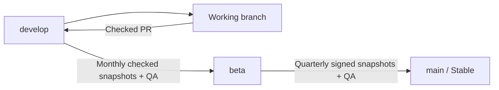

# Git strategy and release channels

Stage0 uses `develop → beta → main`. Nightly is permanently retired: no daily
build, source promotion, release tag, download channel or updater feed may be
reintroduced. Old tags reserve their version numbers and remain historical data.

## Branches and protection

| Branch | Risk / stability | Purpose | Publication |
| --- | --- | --- | --- |
| `origin/develop`, working branches | Highest / unstable | Reviewed development | No packaged release |
| `origin/beta` | Medium / stabilizing | Monthly accumulation of tested development snapshots | Day 27 UTC, after approval and signed builds |
| `origin/main` | Low / stable | Quarterly accumulation of published Beta snapshots | January/April/July/October 1 UTC, after approval and signed builds |

Main is the production authority and GitHub `--latest` release even when Beta
has a larger SemVer. Stable updaters never cross into previews.

`main`, `beta` and `develop` are protected. Never commit/push directly or rewrite
history on them. Every integration requires a PR and successful required Actions
checks on its current head. Keep strict up-to-date checks and all three native
regression gates, release policy tests, promotion checks and human approval
requirements. Do not weaken rules to unblock a promotion.

## One worktree and standard work

Use only `/Users/anhquoctran/Workspaces/stage0`. Never create additional worktrees
or temporary checkouts for features, fixes, reviews or parallel tasks.
Before switching tasks, inspect staged, unstaged and untracked changes and commit
current work on its working branch. Preserve unfinished work; never discard it
or checkpoint on a protected branch. Move changes to an appropriate working
branch first if necessary.

Fetch `origin`, create an approved working branch from `origin/develop` in this
same directory, implement and verify, then push and open a PR targeting
`develop`. Prefixes: `feat/`, `fix/`, `refactor/`, `perf/`, `docs/`, `test/`, `chore/`.
GitHub Pages work stays on its own task branch and website deployment pipeline;
it does not trigger application packaging.

## Calendar release promotion

The canonical policy lives in `shared/release-channels.json`. Full operational
steps and constraints: [release promotion](release_promotion.md).

- Beta: accumulate eligible PR merges into Develop from previous-month day 28
  through current-month day 26 (half-open UTC interval). Eligibility requires
  completed exact-head CI, matching merged/tested trees and immutable evidence.
- Stable: accumulate eligible published, signed Beta builds in the previous
  calendar quarter. All native build targets/assets must pass provenance checks.
- Preserve all eligible sources, shared ancestry, independent fixes, reverts and
  target-only hotfixes. Conflicts stop assembly; never select ours/theirs or
  silently prune commits. Fix/revert upstream and regenerate the complete batch.
- Freeze `promotion/beta/YYYY-MM-DD` → `beta`, or
  `promotion/stable/YYYY-MM-DD` → `main`. Never use an integration branch directly
  as a promotion PR head. Never squash/rebase the approved promotion.
- Record every selected/rejected source, CI run/attempt, SHA and unique commit in
  `.github/release-rollup.json`. Target/head/evidence changes invalidate review.
- Exact assembled-head CodeQL, protected baseline regressions, human smoke QA,
  readiness acknowledgement and independent approval remain mandatory.
- Build and sign all six target platforms after the approved merge. Publish
  only on the scheduled UTC day; skip an empty/unchanged period. There is no
  daily preparation or 24-hour development activity gate.

Controllers execute trusted `main` code and read source revisions only as Git
objects/data. Candidate scripts run in isolated tag cache scopes, never in the
main controller cache. Deploy controller/workflow changes consistently through
reviewed PRs; do not bypass protection to bootstrap deployment.

Versions use monotonically increasing `0.0.x-beta` / `0.0.x`, counting historical
tags to prevent reuse. Each channel's changelog compares source commits with its
previous **published** same-channel release; aliases/drafts/failed tags do not
consume changes. Bundle/About/GitHub notes share that frozen baseline. New
releases never copy a fixed list from an earlier release.

## Hotfixes and downstream synchronization

Branch from the exact affected release branch:
`hotfix/main/<slug>` from `origin/main`, or `hotfix/beta/<slug>` from `origin/beta`.
Open the primary PR against that target. Back-sync through separate checked PRs:

- Main hotfix → Beta and Develop.
- Beta hotfix → Develop; independently address Main if production is affected.

Never merge an entire unstable development branch into a stable tier during
back-sync. Preserve original ancestry or cherry-pick the specific reviewed fix;
resolve conflicts explicitly and verify regressions on each target.

Urgent releases still require certified lower-source evidence, unchanged tested
content, protected regressions, CodeQL, QA and human approval. Beta hotfixes
identify a checked `develop/pr-N/<merge-SHA>` source (24-hour observation);
Stable hotfixes identify a signed published `vX.Y.Z-beta` (168-hour observation).
Declare exactly one `Stage0-Candidate: ...` in the PR body. This certification
path never authorizes arbitrary direct publication from Develop.
