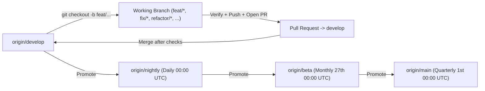
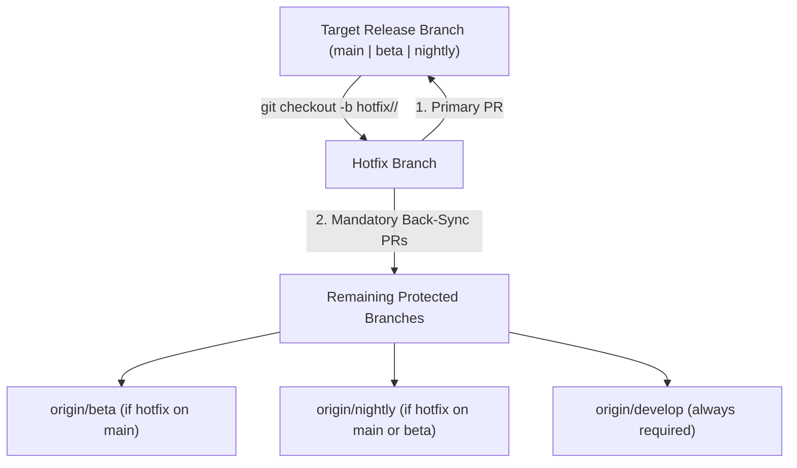

# Git Strategy, Git Flow & Branching Policy

Stage0 enforces a strict multi-channel Git Flow so automated agents and human
contributors never mutate build/release branches directly and every change flows
predictably from integration (`develop`) through preview channels (`nightly`,
`beta`) to production (`main`).

## 1. Protected Long-Lived Branches & Risk Hierarchy

| Branch / Tier | Risk Level | Stability | Role | Direct Commit / Push | Release Cadence (UTC) | Version Format |
|---|---|---|---|---|---|---|
| `feat/*`, `fix/*`, `refactor/*`, `origin/develop` | **Highest (`highest`)** | Least stable (`unstable`) | Active feature/bugfix work & primary integration branch | **Forbidden on `develop`** (PR only) | Continuous integration | Unreleased working tree |
| `origin/nightly` | **High (`high`)** | Preview (`preview`) | Nightly build channel (promoted from `develop`) | **Forbidden** (PR only) | Daily at `00:00 UTC` (build starts `23:00 UTC`) | `0.0.x-nightly` |
| `origin/beta` | **Medium (`medium`)** | Stabilizing (`stabilizing`) | Beta build channel (promoted from `develop` / `nightly`) | **Forbidden** (PR only) | Monthly on the 27th at `00:00 UTC` (build starts 26th `23:00 UTC`) | `0.0.x-beta` |
| `origin/main` | **Low (`low`)** | **Stable (`stable`)** | Production release channel (promoted from `beta` / `develop`) | **Forbidden** (PR only) | Quarterly on day 1 of month 1 (`01/01`, `01/04`, `01/07`, `01/10`) at `00:00 UTC` | `0.0.x` |

- **Risk progression (`develop`/`feat`/`fix` [Highest] → `nightly` [High] → `beta` [Medium] → `main` [Stable])**:
  - Code promotions always flow from higher-risk branches toward lower-risk branches only after verification gates pass.
  - Never merge a higher-risk branch into a lower-risk branch during a hotfix sync (which would leak unstable code into a more stable tier); hotfix synchronization always flows from the lower-risk branch back toward higher-risk branches (`main` → `beta` → `nightly` → `develop`).
- **SemVer vs. Production Stability**:
  - `main` là bản phát hành chính thức (official production release) có **độ ổn định cao nhất** và mức độ rủi ro thấp nhất (`low risk / stable`).
  - **`main` có thể không phải là bản có SemVer lớn nhất tại một thời điểm**: Trong khi `main` giữ nguyên phiên bản ổn định giữa các kỳ release theo quý, các kênh `nightly` (hàng ngày) và `beta` (hàng tháng) liên tục phát hành các bản xem trước với số SemVer tăng dần (`0.0.x-nightly`, `0.0.x-beta`).
  - Dù vậy, vai trò chính thức của `main` là tối thượng:
    - Bản phát hành từ `main` luôn là bản `--latest` chính thức trên GitHub Releases (`prerelease=false`).
    - Website chính thức và hero download luôn ưu tiên tải bản Stable từ `main`.
    - Trình cập nhật ứng dụng (`updater`) phân tách channel riêng biệt (`channel-stable`), người dùng bản chính thức không bao giờ bị cập nhật nhầm sang các bản xem trước dù số SemVer của preview cao hơn.
- **No direct commits or pushes** are permitted on `main`, `beta`, `nightly`, or `develop`.
- **No force-pushes (`--force` / `--force-with-lease`)** or history rewrites on any protected branch.
- Canonical branch, risk and channel metadata is defined in `shared/release-channels.json` and validated by `validateGitFlowBranch` and `branchRiskProfile` in `scripts/release-channels.mjs`.

---

## 2. Standard Development Flow (Feature / Fix / Refactor / Chore)

All standard development **must** branch off `origin/develop` and merge back
into `develop` via Pull Request.



### Naming Conventions for Standard Branches
- `feat/<short-slug>` — New features or user-facing capabilities
- `fix/<short-slug>` — Bug fixes targeting `develop`
- `refactor/<short-slug>` — Structural refactoring without product behavior changes
- `perf/<short-slug>` — Performance improvements
- `docs/<short-slug>` — Documentation updates
- `test/<short-slug>` — Test additions or harness improvements
- `chore/<short-slug>` — Build scripts, CI, or dependency maintenance

### Mandatory Steps for Agents
1. **Sync & branch off `origin/develop`**:
   ```bash
   git fetch origin develop
   git checkout -b feat/<short-slug> origin/develop
   ```
2. **Implement & verify locally**:
   - Run `pnpm check:architecture`, `pnpm typecheck`, relevant Node/Rust tests, and `cargo check --manifest-path backend/Cargo.toml`.
3. **Push working branch & open a PR targeting `develop`**:
   ```bash
   git push -u origin feat/<short-slug>
   gh pr create --base develop --head feat/<short-slug>
   ```

---

## 3. Hotfix Exception & Mandatory Multi-Branch Synchronization

When an urgent bug must be fixed directly on an active release branch (`main`,
`beta`, or `nightly`) without waiting for full `develop` promotion:



### Hotfix Rules
1. **Branch directly from the affected release branch** (`origin/main`, `origin/beta`, or `origin/nightly`):
   ```bash
   git fetch origin <target-branch>
   git checkout -b hotfix/<target-branch>/<short-slug> origin/<target-branch>
   ```
2. **Open the primary PR targeting `<target-branch>`** (`main`, `beta`, or `nightly`).
3. **Synchronize the hotfix back to all downstream/remaining branches** (`policy.gitFlow.syncTargets`):
   - **Hotfix on `main`** → Must sync to **`beta`**, **`nightly`**, and **`develop`**.
   - **Hotfix on `beta`** → Must sync to **`nightly`** and **`develop`** (and `main` if the defect also exists in production).
   - **Hotfix on `nightly`** → Must sync to **`develop`**.
   - If the target branch contains unpromoted commits that should not move into another channel yet, open a cherry-pick PR (`hotfix/sync-<branch>/<short-slug>`) from each remaining branch with `git cherry-pick -x <hotfix-commit>` so only the hotfix is synchronized.
